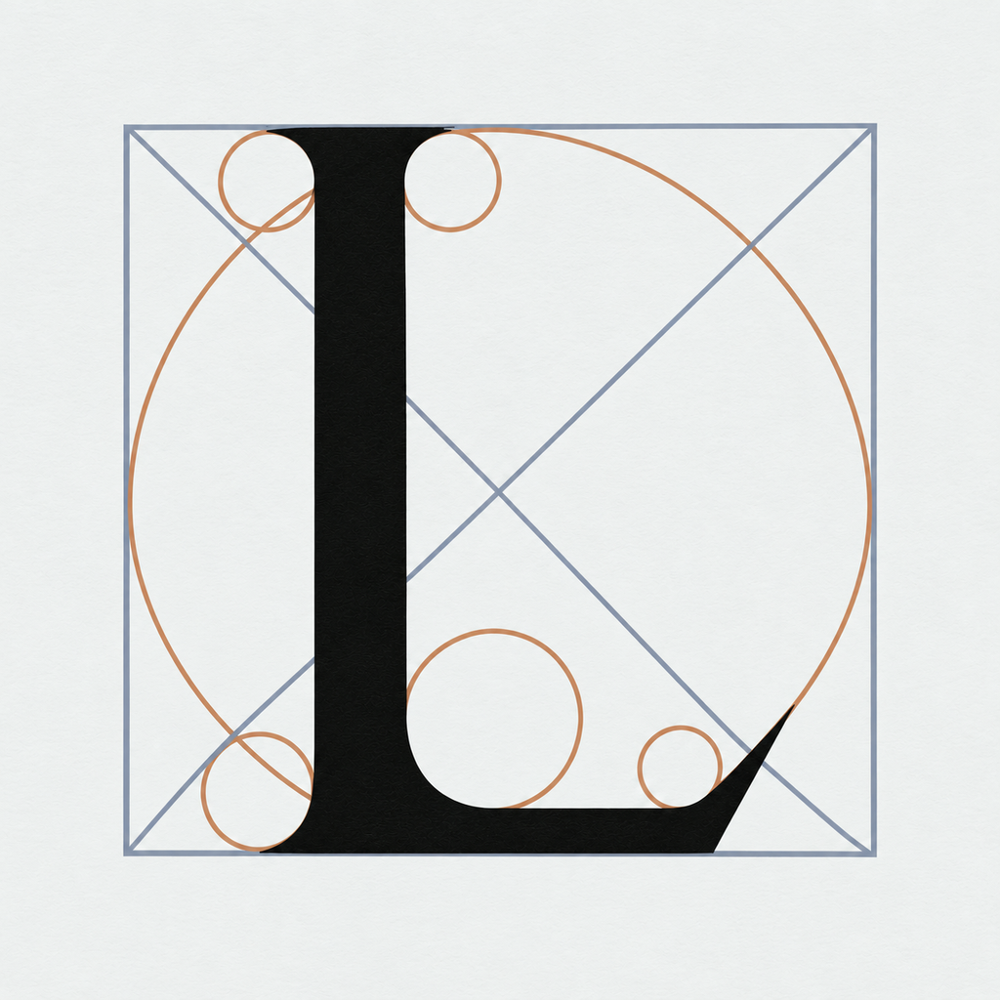
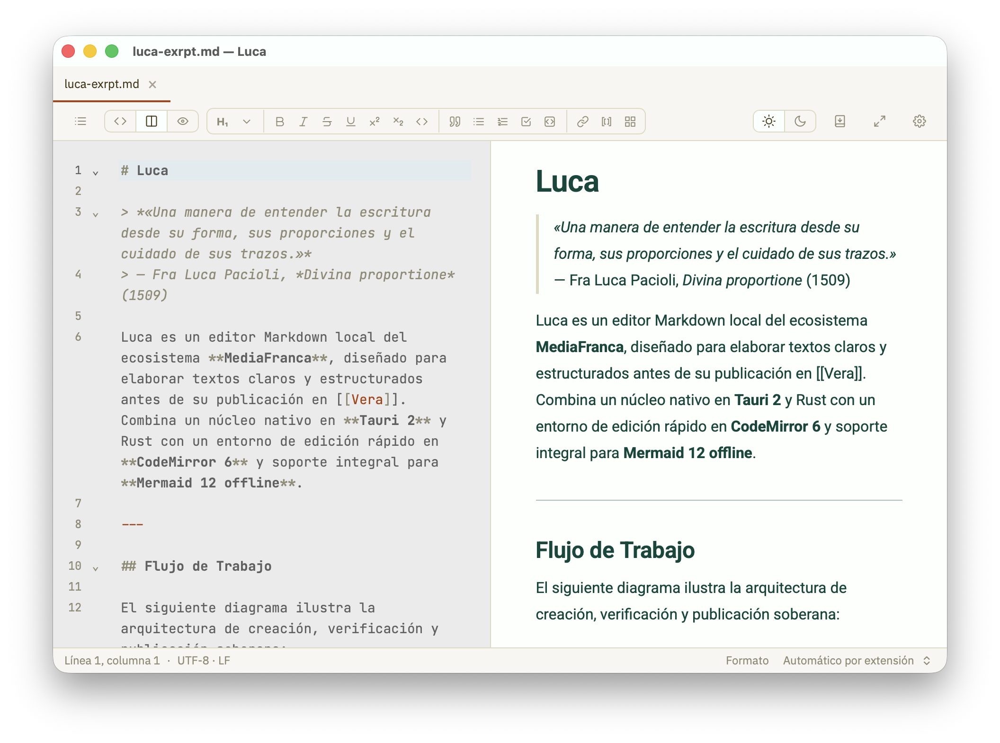

<div align="center">



# Luca

Desktop Markdown and Wikitext editor

[Español](README.md) · **English**
</div>

Luca is a Markdown and Wikitext text editor for macOS, Windows and Linux. It
saves `.md`, `.markdown`, `.wiki`, `.wikitext` and `.txt` files without adding
anything to them: no identifiers, no metadata, no normalisation. The text you
write is the text stored on disk, byte for byte, with its original line
endings.

It is made for writing long texts —chapters, reports, wiki pages, research
notes— that are later published elsewhere. That is why the preview is a
**projection** of the text and never a replacement for it: Mermaid diagrams are
drawn, but the file keeps their code; footnotes are numbered on screen, but
their labels are left untouched.

Luca is an initiative of [MediaFranca](https://mediafranca.net), released as
free software under the [EUPL 1.2](LICENSE).



## Download

[Latest release](https://github.com/mediafranca/luca/releases/latest). Under
**Assets**, choose the file for your system:

| System | File |
| --- | --- |
| macOS (Apple Silicon and Intel) | `Luca_x.y.z_universal.dmg` |
| Windows | `Luca_x.y.z_x64-setup.exe` or `.msi` |
| Linux | `.AppImage`, `.deb` or `.rpm` |

Each release includes `checksums-*.txt` files with the size in bytes and the
SHA-256 of every installer, and a `.sigstore.json` bundle per installer. The
bundles are keyless Sigstore signatures made by the release workflow, and
GitHub stores a provenance attestation for each file:

```sh
gh attestation verify FILE --repo mediafranca/luca \
  --signer-workflow mediafranca/luca/.github/workflows/release.yml
```

The macOS app carries an ad-hoc signature but is not yet notarised by Apple. If
macOS says it cannot be opened, or Luca bounces in the Dock and never opens,
remove the quarantine attribute in Terminal:

```bash
xattr -cr /Applications/Luca.app
```

## What it does

- **Writing.** CodeMirror 6 editor with Markdown and Wikitext highlighting, line
  numbers, find and replace, go to line and multiple selections; a formatting
  bar that emits the syntax of the document's format; a visual table editor;
  footnotes; a command palette (`⌘⇧P` / `Ctrl+Shift+P`) and a shortcut
  reference (`F1`); full-screen zen mode.
- **Reading and reviewing.** Source, split and rendered views. In split view
  editor and preview scroll together in both directions. Clicking a rendered
  block opens its source in place. Offline Mermaid diagrams in strict mode (a
  diagram cannot run code). Local images, audio and video. Heading outline.
  PDF export.
- **Organising work.** Tabs and multiple windows in a single process; atomic
  saves (temporary file and rename) with a warning if another program changed
  the file; optional session restore with recoverable drafts; recent files.
- **Wikitext and MediaWiki.** Per-document format, detected by extension or
  chosen by hand. Preview against any MediaWiki with a public `api.php`; the
  returned HTML is sanitised with DOMPurify.
- **Personalising.** Spanish and English interface; named designs (typefaces,
  measures and light/dark colours) that can be exported and imported as JSON;
  bundled fonts, no downloads.

The [user guide](docs/uso.md) (in Spanish) covers every mode, shortcut and
preference.

## Command line

    luca page.md notes.md
    luca --new
    luca --help
    luca --version

If Luca is already running, files are handed to the existing instance. The
`.deb`, `.rpm` and `.msi` packages install the `luca` command; with the `.dmg`,
the AppImage or the `-setup.exe`, enable it in **Preferences ▸ General ▸
Command line**.

## Principles

- **The text is the source of truth.** Luca saves what you wrote without
  normalising it, and preserves syntax it does not understand, including YAML
  and `key:: value` lines.
- **The preview is a projection.** It may draw, number and link, but it never
  rewrites the document.
- **Nothing is lost silently.** Closing with unsaved changes asks first; so does
  overwriting a file changed by another program.
- **Local first.** Everything works offline except the Wikitext preview, which
  only contacts the wiki you configure.
- **Foreign content has no privileges.** HTML is sanitised, diagrams do not run
  code and a foreign `.md` file has no access to the app.

The verifiable detail lives in [`specs/`](specs/), written in
[Allium](https://github.com/mediafranca).

## Privacy

Luca has no telemetry, no accounts and sends no documents to MediaFranca. Text,
recovery drafts, preferences and recent files stay on the device. The only
network feature is the Wikitext preview, which sends the text over HTTPS to the
MediaWiki API chosen in Preferences, without cookies or credentials. The
exportable diagnostic report contains no text, file names or paths. Full
policy: [docs/privacidad.md](docs/privacidad.md) (in Spanish).

## Accessibility

Luca takes the [Web Content Accessibility Guidelines (WCAG) 2.2](https://www.w3.org/TR/WCAG22/),
level AA, as its reference. Its interface is HTML running in the system
WebView, so the web criteria apply directly. What is in place today, each point
backed by [`specs/accesibilidad.allium`](specs/accesibilidad.allium) and
[`tests/accessibility.test.mjs`](tests/accessibility.test.mjs):

- **Keyboard operation** (WCAG 2.1.1): tabs, commands, preferences and main
  actions can be reached and activated without a pointing device. Tabs move
  with the arrow keys, `Home` and `End`.
- **Visible focus** (2.4.7): every interactive control shows a focus indicator.
  Closing a dialog, the palette or the preferences page returns focus to the
  control that opened it, and `Esc` closes them (2.4.3).
- **Name, role, value** (4.1.2): tabs, regions, dialogs, lists and controls
  expose roles and accessible names, and mark the selected item.
- **Language of page** (3.1.1): the document language follows the interface
  language (Spanish or English).
- **Adaptable presentation** (1.4.4, 1.4.12): typefaces, sizes, measures and
  colours are user preferences, with light and dark themes. The zen-mode
  toolbar animation honours the system's reduced-motion setting.

Not yet verified: there is no formal audit, colour contrast of the default
themes has not been measured, and screen-reader use (VoiceOver, NVDA, Orca) has
not been tested systematically. Accessibility problems are bugs: please report
them in the [issue tracker](https://github.com/mediafranca/luca/issues).

## Building from source

Requires [Rust](https://rustup.rs), the Tauri 2 CLI and
[Node.js](https://nodejs.org).

```bash
npm install
cargo tauri dev      # development
cargo tauri build    # local installers
```

Checks, in the order CI runs them:

```sh
npm ci
npm test
cargo fmt --check --manifest-path src-tauri/Cargo.toml
cargo check --manifest-path src-tauri/Cargo.toml
cargo test --manifest-path src-tauri/Cargo.toml
allium check specs/
```

Luca is a [Tauri 2](https://v2.tauri.app) application: a native Rust process
for windows, menus and files, and a framework-free HTML, CSS and JavaScript
interface in the system WebView. The [Spanish README](README.md#arquitectura)
describes the architecture, source map, roadmap and changelog.

Contributing: [CONTRIBUTING.md](CONTRIBUTING.md) (in Spanish). Dependencies and
licences: [THIRD_PARTY.md](THIRD_PARTY.md).

## About the name

After Luca Pacioli, who studied the geometric construction of letters in
*Divina proportione* (1509). The icon is his «L».

## Licence and ownership

Luca is a [MediaFranca](https://mediafranca.net) initiative, authored by
[Herbert Spencer González](https://github.com/hspencer) and released under the
[European Union Public Licence 1.2](LICENSE).
