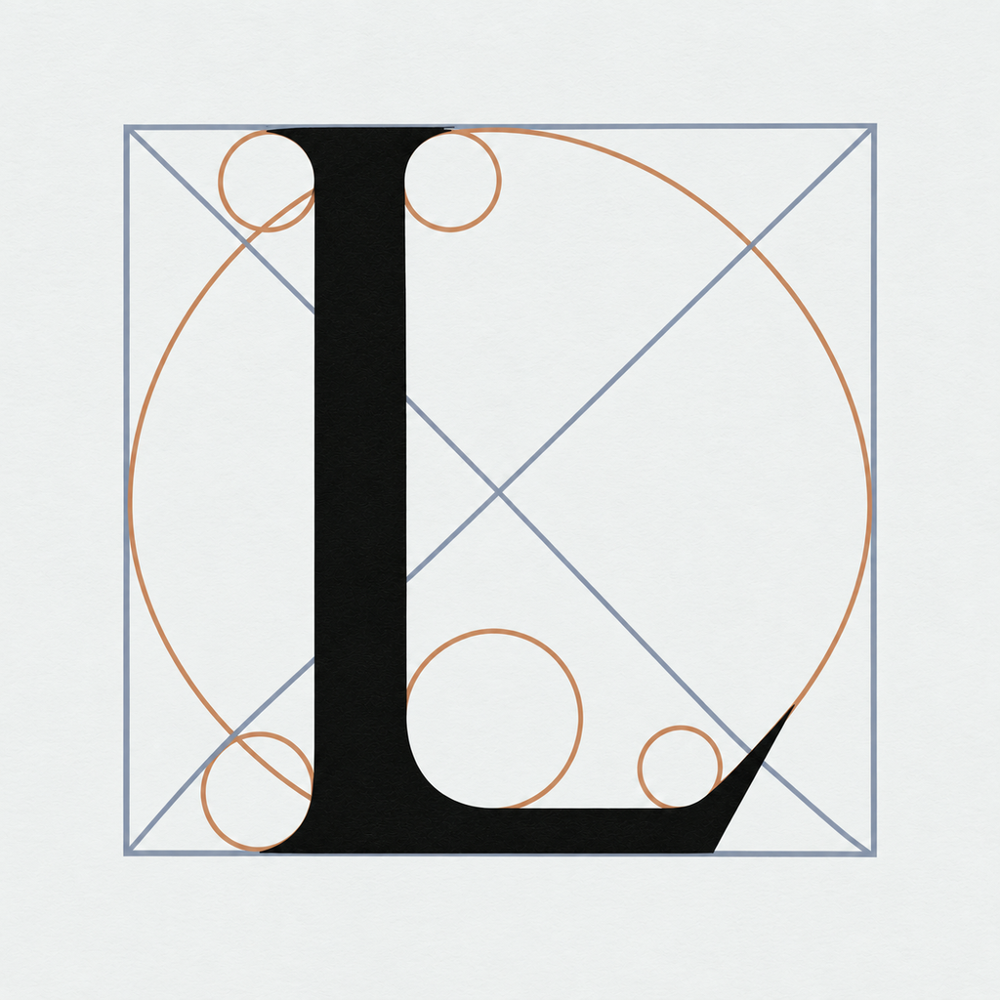
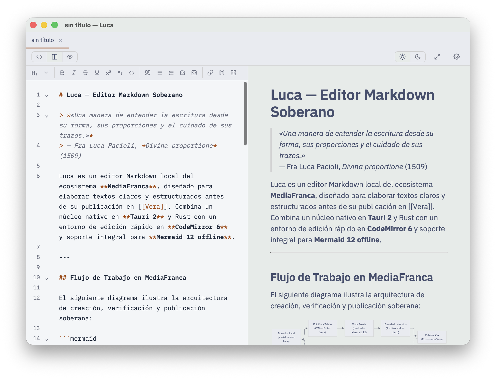

<div align="center">



# Luca

Editor Markdown y Wikitext de escritorio
</div>

Luca es un editor de texto Markdown y Wikitext para macOS, Windows y Linux.
Guarda archivos `.md`, `.markdown`, `.wiki` y `.wikitext` sin añadirles nada.

Consulta la **[Guía de uso](docs/uso.md)** para conocer los modos de edición,
atajos, tablas, diagramas, preferencias y apertura desde el sistema o la línea
de comandos.

## Descargar

[Última versión](https://github.com/mediafranca/luca/releases/latest). En
**Assets**, elige el archivo de tu sistema:

| Sistema | Archivo |
| --- | --- |
| macOS | `Luca_x.y.z_universal.dmg` |
| Windows | `Luca_x.y.z_x64-setup.exe` |
| Linux | `.AppImage`, `.deb` o `.rpm` |

La app de macOS aún no está firmada. Si el sistema dice que no se puede abrir,
usa clic derecho y **Abrir**. Si el aviso persiste, en Terminal:

```bash
xattr -cr /Applications/Luca.app
```

## Qué hace

- Vista de código, vista dividida y vista renderizada (`⌘1`, `⌘2`, `⌘3`).
- En la vista renderizada se puede editar cada bloque en su lugar.
- Modo zen a pantalla completa (`⌘⇧Z`).
- Barra de formato y editor de tablas.
- Diagramas Mermaid, sin conexión.
- Varios documentos en pestañas. Guardado seguro y aviso si otro programa
  cambió el archivo.
- Una sola instancia visible: abrir más archivos los reúne en pestañas de la
  ventana existente. Las pestañas se pueden arrastrar y reordenar.
- Multiselección con ⌘D / Ctrl+D para añadir la siguiente aparición, disponible
  también en el menú Edición.
- Formato por documento con detección por extensión y resaltado Wikitext.
- Exportar a PDF.
- Exportar e importar los tokens de diseño como JSON desde Preferencias.
- Tipografía y colores configurables (`⌘,`), claro y oscuro.



## Línea de comandos

La instalación registra el comando Luca:

    luca pagina.md notas.md
    luca --new
    luca --help
    luca --version

Si Luca ya está abierto, los archivos se entregan a esa ventana.

## Desde el código

Requiere [Rust](https://rustup.rs), la CLI de Tauri 2 y [Node.js](https://nodejs.org).

```bash
npm install
cargo tauri dev
```

- `ui/`: interfaz (HTML, CSS y JavaScript; CodeMirror 6).
- `src-tauri/`: aplicación nativa (Rust, Tauri 2).
- `specs/`: especificación del comportamiento en [Allium](https://github.com/mediafranca).
- `.github/workflows/release.yml`: compila y publica los instaladores al etiquetar `vX.Y.Z`.

Contribuciones: ver [CONTRIBUTING.md](CONTRIBUTING.md).
Dependencias y licencias: ver [THIRD_PARTY.md](THIRD_PARTY.md).

## Cambios por versión

- **0.5.0:** instancia única, apertura múltiple y CLI; pestañas reordenables;
  multiselección; edición por bloques también en vista dividida; enlaces web en
  el navegador predeterminado; identidad pública e instaladores actualizados.
- **0.4.2:** fuentes locales Source Serif 4 y Fira Code.
- **0.4.1:** correcciones de pestañas y mejoras de presentación.

El detalle verificable de cada comportamiento está en [`specs/`](specs/) y la
dirección del producto en [`plan.md`](plan.md).

## Acerca de Luca

Por Luca Pacioli, que en *Divina proportione* (1509) estudió la construcción
geométrica de las letras. El ícono es su «L».

Luca es una iniciativa de **MediaFranca**, creada por **Herbert Spencer**.
Su procedencia y ficha de obra se documentan también en
[Casiopea](https://wiki.ead.pucv.cl/Luca).

## Vera

Luca forma parte de [MediaFranca](https://github.com/mediafranca) y es el editor
externo de [Vera](https://github.com/mediafranca/vera). Vera abre un `.md` en
Luca; Luca lo guarda tal cual. Luca funciona igual sin Vera.

## Licencia

Obra de [Herbert Spencer González](https://github.com/hspencer), bajo la
[EUPL 1.2](LICENSE).

<div align="center">
<br>
<sub>Puño alzado: Eugenio Hansen, OFS,
<a href="https://creativecommons.org/licenses/by-sa/4.0/">CC BY-SA 4.0</a>, vía
<a href="https://commons.wikimedia.org/w/index.php?curid=65787095">Wikimedia Commons</a>.</sub>
</div>
