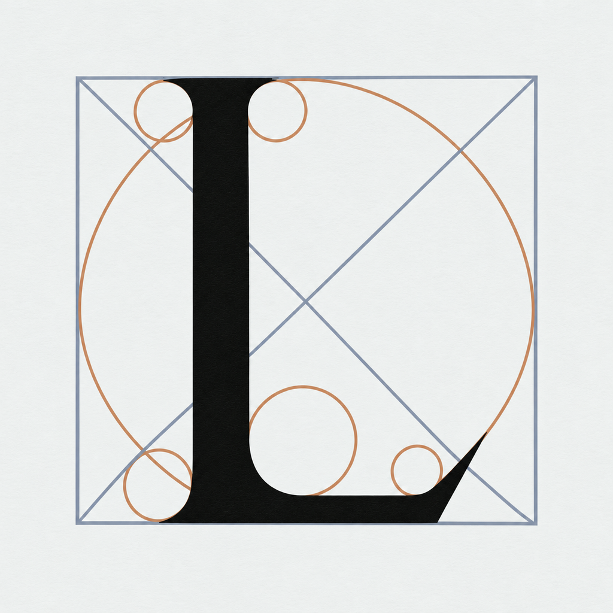
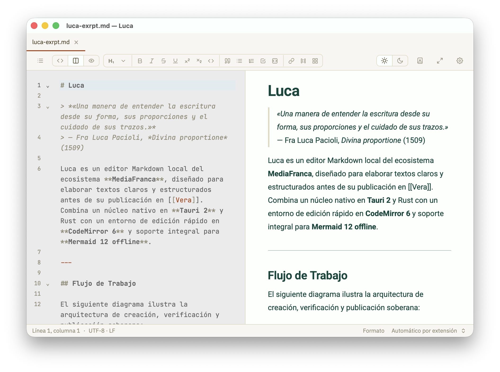
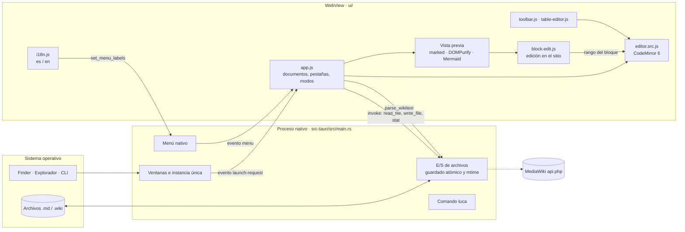
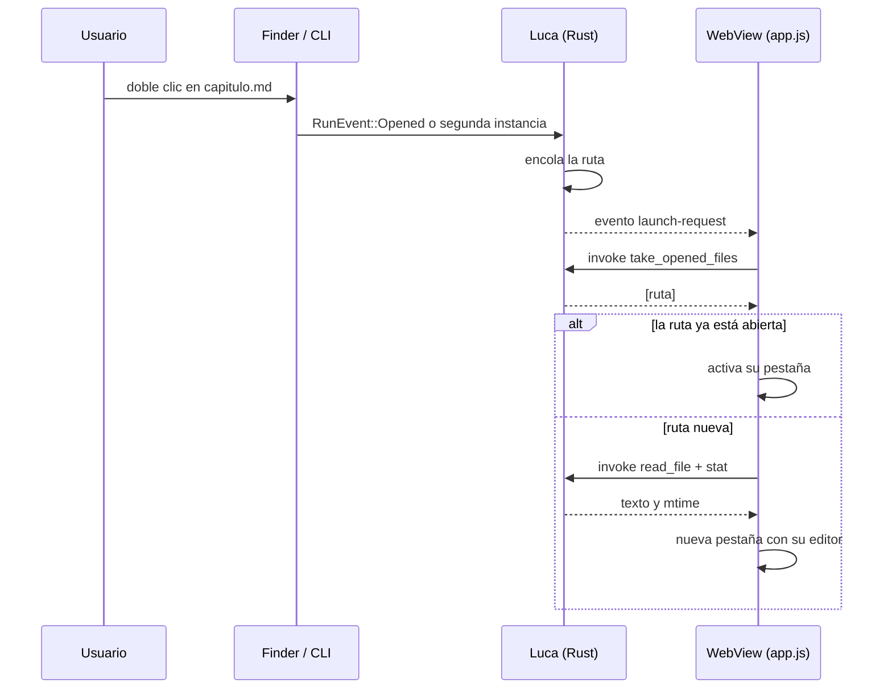
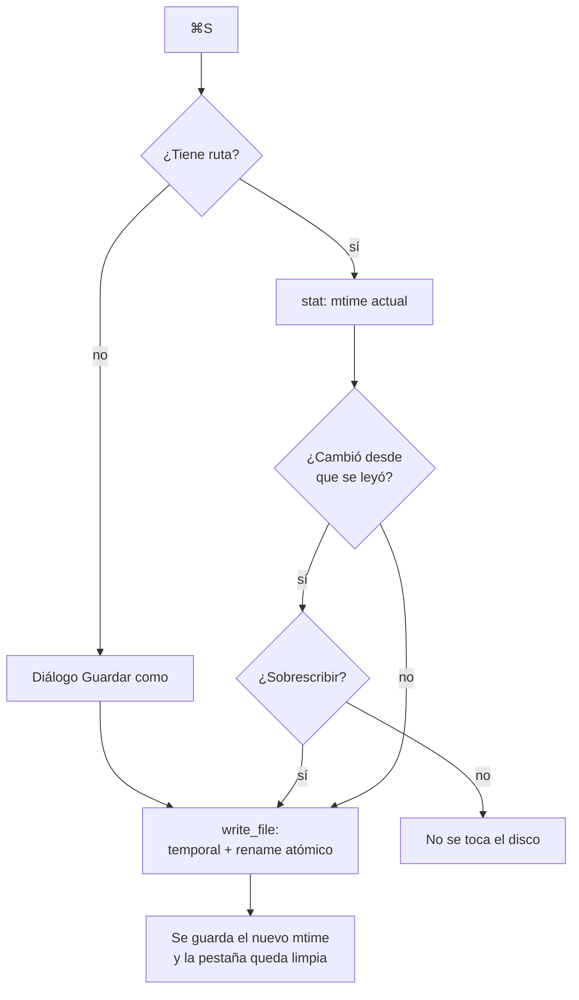
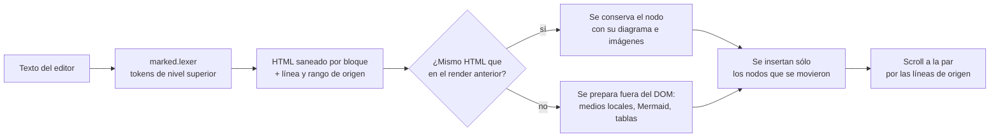

<div align="center">



# Luca

Editor Markdown y Wikitext de escritorio
</div>

Luca es un editor de texto Markdown y Wikitext para macOS, Windows y Linux.
Guarda archivos `.md`, `.markdown`, `.wiki` y `.wikitext` sin añadirles nada:
ni identificadores, ni metadatos, ni normalizaciones. El texto que escribes es
el que queda en disco, byte a byte, con su fin de línea original.

Está pensado para elaborar textos largos —capítulos, informes, páginas de
wiki, notas de investigación— que luego se publican en otro lugar. Por eso la
vista previa es una **proyección** del texto y nunca su sustituto: los
diagramas Mermaid se dibujan, pero el archivo conserva su código; las notas al
pie se numeran en pantalla, pero sus etiquetas no se tocan.

Consulta la **[Guía de uso](docs/uso.md)** para conocer los modos de edición,
atajos, tablas, diagramas, preferencias y apertura desde el sistema o la línea
de comandos.

La **[política de privacidad y conectividad](docs/privacidad.md)** explica qué
datos permanecen locales y cuándo Luca consulta una wiki. La
[línea base de rendimiento](docs/rendimiento.md) registra tamaños y el protocolo
para las mediciones nativas.



## Descargar

[Última versión](https://github.com/mediafranca/luca/releases/latest). En
**Assets**, elige el archivo de tu sistema:

| Sistema | Archivo |
| --- | --- |
| macOS (Apple Silicon e Intel) | `Luca_x.y.z_universal.dmg` |
| Windows | `Luca_x.y.z_x64-setup.exe` o `.msi` |
| Linux | `.AppImage`, `.deb` o `.rpm` |

Cada release incluye archivos `checksums-*.txt` con el tamaño en bytes y el
SHA-256 de los instaladores producidos en macOS, Windows y Linux.

La app de macOS lleva firma ad-hoc pero aún no está notarizada. Si el sistema
dice que no se puede abrir, o Luca rebota en el Dock sin abrir, quita la
cuarentena en Terminal:

```bash
xattr -cr /Applications/Luca.app
```

«Abrir de todos modos» en Ajustes no basta: autoriza la apertura pero no quita
el atributo de cuarentena.

## Qué hace

### Escribir

- Editor CodeMirror 6 con resaltado de Markdown y de Wikitext, numeración de
  líneas, búsqueda y reemplazo, ir a línea y multiselección (`⌘D` / `Ctrl+D`
  añade la siguiente aparición).
- Barra de formato que emite la sintaxis del formato del documento:
  encabezados, énfasis, listas, citas, enlaces, código, tablas y notas al pie.
- Editor visual de tablas, para Markdown (`|`) y Wikitext (`{| … |}`).
- Notas al pie (`⌘⌥F`): en Markdown, la llamada `[^n]` tras la selección y su
  definición al final del documento; en Wikitext, un `<ref>` en el sitio.
- Paleta de comandos (`⌘⇧P`) y diálogo de atajos agrupado por menú (`F1`).
- Modo zen a pantalla completa (`⌘⇧Z`).

### Leer y revisar

- Tres modos de vista: código, dividido y renderizado (`⌘1`, `⌘2`, `⌘3`).
- En la vista dividida, editor y vista previa se desplazan **a la par en ambos
  sentidos**: el panel que mueves manda y el otro lo sigue bloque a bloque.
- En la vista renderizada y en la dividida, pulsar un bloque lo abre con su
  Markdown en el sitio, con la tipografía del texto renderizado.
- La vista previa sólo rehace los bloques que cambiaron: los diagramas y las
  imágenes que no tocaste no se vuelven a dibujar.
- Diagramas Mermaid sin conexión, con los motores ELK, tidy-tree y ZenUML
  empaquetados, y en modo estricto: un diagrama no ejecuta código.
- Imágenes, audio y vídeo con rutas relativas al archivo abierto.
- Esquema de encabezados como panel lateral opcional.
- Exportar a PDF, siempre en papel claro aunque la pantalla esté en oscuro.

### Organizar el trabajo

- Varios documentos en pestañas, cada uno con su editor, historial, cursor y
  scroll. Reabrir una ruta activa la pestaña existente.
- Una sola instancia del proceso, con una o varias ventanas. Las pestañas se
  reordenan, se separan en una ventana nueva y se vuelven a reunir.
- Guardado atómico (temporal y reemplazo) y aviso si otro programa cambió el
  archivo desde que lo abriste.
- Sesión restaurable: pestañas, documento activo y borradores sin guardar,
  que conservan la fecha con que se leyó el archivo para detectar ediciones
  externas hechas con Luca cerrada. Se puede desactivar en Preferencias.
- Recientes en **Archivo ▸ Abrir reciente**.
- En macOS, cerrar la última pestaña deja la app en la barra de menús.

### Wikitext y MediaWiki

- Formato por documento, detectado por extensión o elegido a mano.
- Vista previa contra cualquier MediaWiki con `api.php` público, con la opción
  de aplicar las CSS de esa wiki, aisladas del resto de la interfaz y
  siguiendo el tema claro u oscuro de Luca.
- El HTML que devuelve la wiki se sanea con DOMPurify antes de mostrarse.

### Personalizar

- Interfaz en español e inglés, según el sistema o a elección (`⌘,`).
- Diseños con nombre: tipografías, medidas y colores de los temas claro y
  oscuro, guardados como un juego que se duplica, se elimina y se exporta o
  importa como JSON.
- Paleta de Mermaid propia de Luca o uno de los temas de Mermaid.
- Fuentes locales, sin descargas: IBM Plex Sans, Serif y Mono, Source Serif 4,
  Roboto, Roboto Serif, Fira Code y JetBrains Mono.

## Línea de comandos

    luca pagina.md notas.md
    luca --new
    luca --help
    luca --version

Si Luca ya está abierto, los archivos se entregan a la instancia existente y se
activa la ventana que corresponda.

Que el comando exista depende del instalador:

| Instalación | ¿Queda el comando `luca`? |
| --- | --- |
| `.deb` / `.rpm` | Sí: instalan `/usr/bin/luca`. |
| `.msi` (Windows) | Sí: el instalador añade su carpeta al `PATH`. |
| `.dmg` (macOS) | No: el ejecutable vive dentro de `Luca.app`. |
| `.AppImage` | No: no instala nada fuera del archivo. |
| `-setup.exe` (Windows) | No. |

En los tres últimos casos, **Preferencias ▸ Generales ▸ Línea de comandos**
ofrece instalarlo: Luca crea un enlace en una carpeta que ya esté en tu `PATH` y
en la que puedas escribir, sin pedir contraseña y sin modificar el `PATH`. Si
prefieres hacerlo a mano:

```sh
# macOS y Linux (AppImage). Elige una carpeta de tu PATH donde puedas escribir.
ln -s /Applications/Luca.app/Contents/MacOS/luca /usr/local/bin/luca   # macOS
ln -s ~/Aplicaciones/Luca.AppImage ~/.local/bin/luca                   # AppImage
```

```powershell
# Windows, si instalaste con -setup.exe: añade la carpeta a tu PATH de usuario.
$luca = "$env:LOCALAPPDATA\Programs\Luca"
[Environment]::SetEnvironmentVariable(
  "Path", [Environment]::GetEnvironmentVariable("Path", "User") + ";$luca", "User")
```

## Principios

Estas garantías orientan cada cambio. El detalle verificable está en
[`specs/`](specs/), escrito en [Allium](https://github.com/mediafranca).

- **El texto es la fuente de verdad.** Luca guarda lo que escribiste, sin
  normalizarlo. Preserva la sintaxis que no conoce, incluido YAML y líneas
  `clave:: valor`.
- **La vista previa es una proyección.** Puede dibujar, numerar y enlazar,
  pero nunca reescribe el documento.
- **Nada se pierde en silencio.** Cerrar con cambios pide confirmación;
  sobrescribir un archivo modificado por otro programa también.
- **Local primero.** Todo funciona sin conexión salvo la vista previa
  Wikitext, que sólo consulta la wiki que configures.
- **Contenido ajeno, sin privilegios.** El HTML se sanea, los diagramas no
  ejecutan código y un `.md` ajeno no tiene acceso a la app.

## Arquitectura

Luca es una aplicación [Tauri 2](https://v2.tauri.app): un proceso nativo en
Rust que gestiona ventanas, menús y archivos, y una interfaz web en HTML, CSS y
JavaScript sin framework que corre en el WebView del sistema (WebKit en macOS
y Linux, WebView2 en Windows). Por eso los instaladores pesan unos pocos
megabytes.



El texto vive en CodeMirror. Todo lo demás —vista previa, esquema, sesión,
título de la pestaña— se deriva de él.

### Abrir un archivo desde el sistema

Una segunda instancia nunca abre otra app: entrega las rutas a la que ya está
corriendo, que avisa al frontend y éste las recoge.



### Guardar sin perder nada



### Del texto a la vista previa

La vista previa se rehace tras una pausa breve al escribir y sólo toca lo que
cambió.



Cada bloque renderizado lleva la línea y el rango del texto de donde salió.
Esa marca alimenta tres cosas: el scroll sincronizado, la edición en el sitio
(que reemplaza sólo ese rango del documento) y el botón de edición de tablas.

### Mapa de fuentes

| Archivo o carpeta | Responsabilidad |
| --- | --- |
| `ui/app.js` | Documentos y pestañas, apertura y guardado, vista previa, modos, preferencias e IPC con Tauri. |
| `ui/editor.src.js` | API del editor CodeMirror 6, temas y medición tipográfica. Se empaqueta con esbuild. |
| `ui/block-edit.js` | Edición por bloques en la vista renderizada. |
| `ui/toolbar.js`, `ui/table-editor.js` | Barra de formato y editor visual de tablas, según el formato del documento. |
| `ui/format-syntax.js` | Sintaxis por formato (inline, encabezados, listas, bloques, enlaces). |
| `ui/markdown-table.js`, `ui/wikitext-table.js` | Lectura y escritura de tablas sobre un mismo modelo. |
| `ui/footnotes.js` | Inserción de notas al pie y su extensión para marked. |
| `ui/preview-behavior.js` | Enlaces, anclas, CSS de la wiki y cálculo del scroll a la par. |
| `ui/session-state.js`, `ui/settings-state.js` | Sesión restaurable, recientes, diseños y migración de preferencias. |
| `ui/i18n.js` | Catálogo de interfaz (es/en). Única fuente de texto de la app, también del menú nativo. |
| `ui/index.html` | DOM, estilos, tokens de diseño, fuentes locales, modos, zen e impresión. |
| `src-tauri/src/main.rs` | E/S de archivos, ventanas, menú nativo, instancia única, CLI y apertura desde el sistema. |
| `src-tauri/tauri.conf.json` | Empaquetado, CSP, ventana y asociaciones de archivo. |
| `scripts/vendor.mjs` | Copia las dependencias de ejecución y empaqueta CodeMirror. |
| `specs/*.allium` | Contratos de comportamiento. |

## Desde el código

Requiere [Rust](https://rustup.rs), la CLI de Tauri 2 y [Node.js](https://nodejs.org).

```bash
npm install
cargo tauri dev      # desarrollo
cargo tauri build    # instaladores locales
```

Los hooks de Tauri ejecutan `npm run vendor`, que reconstruye siempre
`ui/vendor/` (no se versiona).

Comprobaciones, en el orden en que las corre el CI:

```sh
npm ci
npm test                                         # tests de Node + empaquetado
cargo fmt --check --manifest-path src-tauri/Cargo.toml
cargo check --manifest-path src-tauri/Cargo.toml
cargo test --manifest-path src-tauri/Cargo.toml  # tests de Rust
allium check specs/                              # specs, si tienes la CLI
```

Que los tests pasen no prueba que la app funcione: los cambios que tocan la
interfaz se verifican abriendo Luca en Tauri. Etiquetar `vX.Y.Z` dispara
`.github/workflows/release.yml`, que compila y publica los instaladores de las
tres plataformas.

Contribuciones: ver [CONTRIBUTING.md](CONTRIBUTING.md).
Dependencias y licencias: ver [THIRD_PARTY.md](THIRD_PARTY.md).

## Hoja de ruta

```mermaid
flowchart LR
  subgraph HECHO["Hecho · 0.7"]
    direction TB
    h1["Interfaz es / en"]
    h2["Diseños con nombre"]
    h3["Notas al pie"]
    h4["Scroll a la par<br/>y render incremental"]
  end
  subgraph PROX["Próximo"]
    direction TB
    p1["Fluidez al escribir"]
    p2["Prueba de humo nativa"]
    p3["Un solo despachador<br/>de comandos"]
  end
  subgraph DIST["Distribución"]
    direction TB
    d1["Notarización macOS"]
    d2["Cask de Homebrew"]
    d3["Flathub"]
  end
  subgraph ABIERTO["Por decidir"]
    direction TB
    a1["Vista rápida con Espacio"]
    a2["luca --wait"]
    a3["Protocolo con Vera"]
  end
  HECHO --> PROX --> DIST --> ABIERTO
```



### Próximo: fluidez al escribir

- **Bloque activo resaltado** en la vista previa, siguiendo al cursor.
- **Cierre automático** de `**`, `` ` ``, `[]` y `()` al escribir sobre una
  selección.
- **Continuar listas** con Enter y salir de ellas con un Enter vacío.
- **Pegar una URL sobre una selección** para convertirla en enlace.
- Realinear el scroll cuando una imagen termina de cargar después del render.

### Próximo: solidez

- **Prueba de humo en la app nativa**: documento inicial, entrada de teclado,
  abrir, guardar y presencia de la barra. Hoy esa verificación es manual y es
  la que más falta ha hecho.
- **Un solo despachador de comandos** para menú, teclado y paleta, con pruebas
  de abrir y guardar.
- Traducir los textos que aún no pasan por el catálogo (`luca --help`, el
  botón de edición de tablas).
- Reunir ventanas informando de todos los fallos, no sólo del primero.
- Paridad del instalador `-setup.exe` de Windows con el `.msi` en el `PATH`.

### Distribución

- **Firmas independientes.** Cada instalador se firma con Sigstore usando la
  identidad efímera del workflow y recibe una attestation de procedencia de
  GitHub. Esto permite comprobar origen e integridad sin custodiar una clave
  privada de larga duración; no sustituye la confianza propia de Gatekeeper o
  SmartScreen.
- **Cask de Homebrew.** `brew install --cask luca` dejaría la app lista sin
  tocar la cuarentena. Sin coste.
- **Flatpak independiente.** Se puede generar un bundle o repositorio propio y
  distribuirlo desde GitHub Releases. Flathub es una ruta distinta: exige que
  una persona escriba el manifiesto y toda la propuesta, prohíbe asistencia de
  IA en ese material y evalúa por separado el código generado que se declare.

### Por decidir

Preguntas abiertas en las specs, que esperan una necesidad concreta:

- Vista previa renderizada al pulsar Espacio en el explorador de cada sistema
  (Quick Look en macOS, Preview Handler en Windows, Sushi en Linux).
- `luca --wait <ruta>`, para que otra herramienta sepa cuándo se cerró el
  documento.
- Un protocolo mayor con Vera (deep-link o RPC) sólo si hace falta; hoy la
  integración son las asociaciones de archivo.
- En la edición por bloques: dónde cae el cursor al señalar un bloque, y si
  Enter al final de un párrafo crea un bloque nuevo o un salto dentro del
  mismo.

## Cambios por versión

- **0.7.7:** abre y guarda texto plano (`.txt`) sin imponer marcado, barra de
  formato ni esquema; registra Luca como editor alternativo de esos archivos.
  Los instaladores se publican como borrador con firmas Sigstore keyless,
  attestations de procedencia y comprobación por hashes.
- **0.7.6:** el editor y la vista previa se desplazan a la par en ambos
  sentidos; la vista previa sólo rehace los bloques que cambiaron y un
  diagrama editado se mantiene hasta que el nuevo está listo; menos trabajo
  por pulsación (sesión, esquema y copia del texto); README ampliado con
  arquitectura y hoja de ruta.
- **0.7.5:** notas al pie (`⌘⌥F`), ayuda de atajos agrupada en Preferencias,
  borradores restaurados que detectan ediciones externas y Mermaid en modo
  estricto.
- **0.7.4:** doble clic desde el Finder abre el archivo correcto, restaurar la
  sesión pasa a ser opcional y en macOS se pueden cerrar todos los documentos
  sin salir.
- **0.7.3:** recupera el build de macOS (firma ad-hoc) y la vista previa de la
  wiki sigue el tema claro u oscuro.
- **0.7.1:** interfaz en español e inglés, diseños con nombre, CSS de la wiki
  e instalación del comando `luca` desde Preferencias.
- **0.6.1:** rescate de 0.6.0: CSP que bloqueaba los estilos de CodeMirror,
  confirmaciones que no bloqueaban, guardado byte-fiel CRLF, barra y tablas
  según el formato, recientes en el menú Archivo y esquema como panel lateral.
- **0.6.0:** edición Markdown y Wikitext por documento; preview MediaWiki
  saneada; paleta, ayuda, búsqueda, esquema, recuperación y recientes; pestañas
  entre ventanas; migración de preferencias, diagnóstico exportable y permisos
  de red/archivos más estrechos. Retirada: no usar.
- **0.5.0:** instancia única, apertura múltiple y CLI; pestañas reordenables;
  multiselección; edición por bloques también en vista dividida; enlaces web en
  el navegador predeterminado; identidad pública e instaladores actualizados.
- **0.4.2:** fuentes locales Source Serif 4 y Fira Code.
- **0.4.1:** correcciones de pestañas y mejoras de presentación.

El informe del rescate de 0.6 está en [`plan.md`](plan.md).

## Acerca de Luca

Por Luca Pacioli, que en *Divina proportione* (1509) estudió la construcción
geométrica de las letras. El ícono es su «L».

Luca es una iniciativa de **MediaFranca**, creada por **Herbert Spencer**.
Su procedencia y ficha de obra se documentan también en
[Casiopea](https://wiki.ead.pucv.cl/Luca).

## Vera

Luca forma parte de [MediaFranca](https://github.com/mediafranca) y fue pensado
para ser el editor externo nativo para [Vera](https://github.com/mediafranca/vera).

## Licencia

Obra de [Herbert Spencer González](https://github.com/hspencer), bajo la
[EUPL 1.2](LICENSE).

<div align="center">
<br>
<sub>Puño alzado: Eugenio Hansen, OFS,
<a href="https://creativecommons.org/licenses/by-sa/4.0/">CC BY-SA 4.0</a>, vía
<a href="https://commons.wikimedia.org/w/index.php?curid=65787095">Wikimedia Commons</a>.</sub>
</div>
