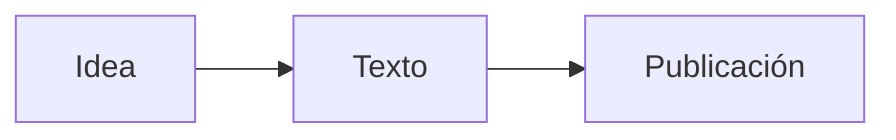

# Guía de uso de Luca

Luca es un editor local de Markdown y Wikitext. El texto del archivo es siempre la fuente
de verdad: la vista previa, la barra de formato y el editor de tablas modifican
Markdown ordinario y Luca no añade metadatos propios al guardar.

## Crear, abrir y guardar

| Acción | macOS | Windows y Linux |
| --- | --- | --- |
| Nuevo documento | `⌘N` | `Ctrl+N` |
| Abrir | `⌘O` | `Ctrl+O` |
| Guardar | `⌘S` | `Ctrl+S` |
| Guardar como | `⌘⇧S` | `Ctrl+Shift+S` |
| Cerrar pestaña | `⌘W` | `Ctrl+W` |
| Exportar PDF | `⌘E` | `Ctrl+E` |
| Preferencias | `⌘,` | `Ctrl+,` |

Abrir un archivo crea una pestaña. Si la misma ruta ya está abierta, Luca
activa esa pestaña en lugar de duplicarla. Siempre queda al menos un documento
abierto. Antes de cerrar una pestaña con cambios sin guardar, Luca pide
confirmación.

El guardado escribe primero un archivo temporal y después reemplaza el destino.
Antes de sobrescribir, Luca compara la fecha de modificación conocida con la del
archivo en disco y avisa si otro programa lo cambió.

Las imágenes y otros medios con rutas relativas se resuelven respecto de la
carpeta del archivo guardado. Un documento nuevo todavía no tiene una carpeta
base; guárdalo antes si la vista previa necesita recursos relativos.

## Pestañas y apertura desde otros programas

Puedes arrastrar las pestañas para reordenarlas. También puedes mover la pestaña
activa con `Alt+Shift+←` y `Alt+Shift+→`. El texto, los cambios pendientes, el
historial, la selección, el cursor y el desplazamiento pertenecen a cada
documento y se conservan al cambiar o mover una pestaña.

Luca funciona como una sola instancia del proceso, que puede tener varias
ventanas. Abrir uno o varios archivos desde el sistema o ejecutar otra vez el
programa entrega esos archivos a la instancia existente; si una ruta ya está
abierta, restaura y enfoca la ventana que la contiene.

La instalación registra el comando `luca`:

```text
luca pagina.md notas.md
luca --new
luca --help
luca --version
```

Usa `--` antes de una ruta que empiece con guion. Las rutas repetidas activan la
pestaña existente.

El selector **Recientes** de la barra superior conserva hasta veinte rutas, sin
duplicados. Al iniciar, Luca restaura las pestañas de la sesión anterior. Para
documentos sucios o sin ruta guarda una instantánea local de recuperación; esa
instantánea nunca sobrescribe el archivo. Los borradores de más de 2 millones de
caracteres no se duplican en el almacenamiento del WebView. Cerrar la ventana
con cambios pendientes pide confirmación.

### Varias ventanas

`⌘⇧N` / `Ctrl+Shift+N` crea una ventana. **Ventana → Mover pestaña a nueva
ventana** (`⌘⇧M` / `Ctrl+Shift+M`) y arrastrar fuera de la barra separan una
pestaña; **Reunir todas las ventanas** las mueve a la ventana actual. La
transferencia conserva texto sucio, historial, selección y cursores múltiples,
scroll, formato y modo de vista. Una ruta tiene un único dueño: abrirla desde
otra ventana enfoca la que ya la contiene.

## Modos de trabajo

- **Código** (`⌘1` / `Ctrl+1`) muestra sólo el editor Markdown.
- **Vista dividida** (`⌘2` / `Ctrl+2`) muestra editor y proyección renderizada.
- **Texto renderizado** (`⌘3` / `Ctrl+3`) muestra sólo la proyección.
- **Modo zen** (`⌘⇧Z` / `Ctrl+Shift+Z`) oculta el entorno visual para concentrar
  la atención. La barra reaparece al acercar el puntero a la parte superior.

En las vistas dividida y renderizada puedes pulsar un bloque de la proyección
para editar su Markdown en el mismo lugar. Al terminar, el cambio vuelve al
documento fuente. La vista previa nunca sustituye ni se guarda sobre el archivo.

En vista dividida, el desplazamiento del editor y la proyección se sincroniza a
partir de la posición del cursor y los bloques correspondientes.

## Formato del documento

La barra de estado permite elegir **Automático por extensión**, **Markdown** o
**Wikitext** para cada pestaña. Automático interpreta `.md` y `.markdown` como
Markdown, y `.wiki` y `.wikitext` como Wikitext. En archivos sin extensión
conocida usa el formato inicial de los documentos nuevos.

Una selección explícita se recuerda por ruta en el estado local de Luca. Si no
coincide con la extensión aparece un aviso, pero Luca permite guardar y nunca
convierte el contenido. En un documento todavía sin ruta, la elección permanece
en la pestaña y se asocia al guardar.

Wikitext ofrece edición fuente y resaltado de títulos, énfasis,
listas, enlaces, plantillas, parámetros, comentarios, tablas, etiquetas y
referencias. La barra de herramientas y el editor de tablas emiten el marcado
del formato activo: en Wikitext insertan `'''negrita'''`, `''cursiva''`,
`== títulos ==`, listas `*` y `#`, `<blockquote>`, `<pre>`, enlaces
`[https://… texto]` y tablas `{| … |}`. La lista de tareas no tiene equivalente
en Wikitext y su botón se oculta.

La vista previa Wikitext usa la API `action=parse` de la wiki HTTPS configurada
en Preferencias; Casiopea es el valor inicial. Luca muestra la wiki usada y el
estado actualizando, actual, sin conexión, error o caché. El HTML recibido se
sanea antes de insertarlo y la solicitud no reutiliza cookies del navegador. Los
cambios rápidos se agrupan y las respuestas obsoletas se descartan. Editar y
guardar siguen funcionando sin red.

## Selecciones múltiples

`⌘D` o `Ctrl+D` añade la siguiente aparición del texto seleccionado. Repite el
atajo para añadir más coincidencias. Si no hay una selección, el editor toma la
palabra bajo el cursor. Al escribir, borrar o pegar, la operación se aplica a
todos los cursores. La misma acción aparece en el menú **Edición**.

## Buscar, navegar y descubrir comandos

- `⌘F` / `Ctrl+F` abre buscar y reemplazar.
- `⌘⇧L` / `Ctrl+Shift+L` selecciona todas las coincidencias de la búsqueda.
- `⌘⌥G` / `Ctrl+Alt+G` permite ir a una línea.
- `⌘⇧P` / `Ctrl+Shift+P` abre la paleta, que busca por nombre o atajo.
- `F1` muestra la ayuda completa de atajos.

La paleta, los menús y los controles visibles ejecutan las mismas operaciones;
no hay funciones reservadas exclusivamente a quien recuerde un atajo.

El selector **Esquema** enumera los encabezados Markdown o Wikitext y mueve el
cursor al elegido. La barra inferior muestra línea, columna, codificación UTF-8,
fin de línea original (`LF`, `CRLF` o `CR`) y formato interpretado.

## Barra de formato

La barra actúa sobre la selección o inserta una estructura vacía en el cursor.
Incluye:

- párrafo y encabezados H1–H6;
- negrita, cursiva, tachado, subrayado, superíndice, subíndice y código en línea;
- cita, listas con viñetas o números, tareas y bloque de código;
- enlace Markdown, enlace interno `[[página]]` y tabla.

Subrayado, superíndice, subíndice y enlaces internos son extensiones legibles que
no todos los procesadores Markdown interpretan. Luca conserva cualquier sintaxis
que no entienda.

## Editor de tablas

Con el cursor dentro de una tabla Markdown, el botón de tabla abre esa tabla en
un editor bidimensional. Fuera de una tabla crea una nueva de tres columnas y
tres filas.

El editor permite:

- añadir y eliminar filas o columnas;
- usar la primera fila o la primera columna como encabezado;
- alinear cada columna a izquierda, centro o derecha;
- aplicar negrita, cursiva, código y enlaces dentro de una celda;
- pegar celdas separadas por tabuladores y filas separadas por saltos de línea,
  como las copiadas desde Excel o Google Sheets;
- copiar una región tabular para volver a pegarla en una hoja de cálculo.

Guardar el diálogo sustituye únicamente el rango Markdown de la tabla. Cancelar
lo deja intacto.

## Mermaid

Un bloque cercado con lenguaje `mermaid` se representa como diagrama:

````markdown

````

Luca distribuye Mermaid y los motores ELK, tidy-tree y ZenUML como recursos
locales. Cuando un diagrama no es válido, la vista previa muestra el error sin
modificar el fence original. Luca interpreta sólo los fences `mermaid`; los
demás bloques cercados se muestran como código.

## Enlaces

Los enlaces `http` y `https` de la vista previa y de **Acerca de Luca** se abren
en el navegador predeterminado. Los fragmentos `#seccion` navegan dentro del
documento actual. Luca no usa su ventana principal como navegador web.

## Apariencia y preferencias

Luca sigue el modo claro u oscuro y permite ajustar por separado los tokens de
interfaz, código y lectura: tipografías, tamaños y colores. Las fuentes incluidas
son locales. Después de cargarlas, el editor vuelve a medir el texto para evitar
desajustes de cursor y líneas.

Desde Preferencias puedes elegir el tema de Mermaid, restaurar los valores
predeterminados y exportar o importar todos los tokens como JSON. La importación
reemplaza los valores configurables por los del archivo elegido; conserva una
copia del JSON si quieres poder volver a una configuración anterior.

**Exportar diagnóstico…** guarda información técnica y conteos de pestañas sin
texto, nombres o rutas de documentos, recientes, credenciales o dirección de la
wiki. Consulta la [política de privacidad y conectividad](privacidad.md).

## Paquetes en Linux

Los paquetes `.deb` y `.rpm` se integran con el menú de aplicaciones, el icono y
las asociaciones que soporte el escritorio. AppImage es el paquete portátil:
puede ejecutarse sin instalación, pero la integración permanente de iconos,
menús y asociaciones depende del escritorio o de una herramienta de integración
de AppImage.

## Límites actuales

- La preview Wikitext depende de la sintaxis, plantillas y extensiones de la wiki
  configurada; no pretende ser un parser universal.
- No convierte documentos ni normaliza saltos de línea deliberadamente.
- La vista del navegador sirve para revisar la interfaz, pero no reproduce los
  diálogos, menús, asociaciones, apertura del sistema ni escritura nativa de
  Tauri.
- Los instaladores de cada plataforma deben probarse en su propio sistema.
